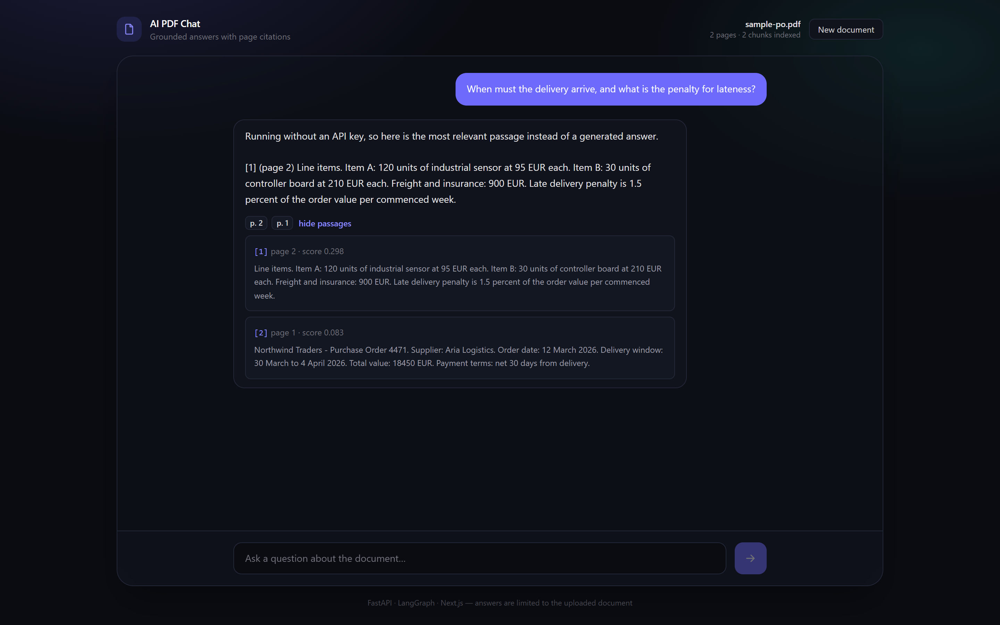
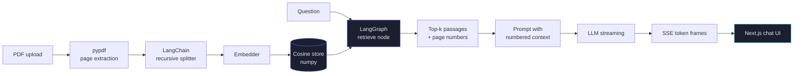

<div align="center">

# AI PDF Chat

**Upload a PDF, ask questions, get answers that cite the page they came from.**

Streaming answers · page-level citations · runs without an API key

[](https://github.com/MrFox2000/ai-pdf-chat/actions/workflows/ci.yml)
[](backend/pyproject.toml)
[](frontend/package.json)
[](backend/tests)



</div>

---

## What it does

Most "chat with your PDF" demos are a single prompt stuffed with scraped text. This
one is built the way a production retrieval system is built:

- **Page-aware ingestion.** The PDF is parsed page by page, so every passage keeps
  the page number it came from. Chunks never silently span two pages.
- **Real retrieval before generation.** The question is embedded, the document is
  searched by cosine similarity, and only the top-k passages reach the model.
- **Citations on every answer.** The UI shows `p. 3` chips for every source and can
  expand the exact passages with their similarity scores.
- **Streaming by default.** The answer arrives token by token over server-sent
  events instead of waiting for the whole completion.
- **Works with no API key.** A deterministic hashing embedder and an extractive
  answer path mean `git clone` → `docker compose up` gives a working app in one
  minute, with nothing to sign up for.

## Architecture



The retrieval step is a compiled **LangGraph** state machine
([`backend/app/rag.py`](backend/app/rag.py)). It has one node today and room for
more: a relevance grader, a query rewriter, or a retry loop can be added without
touching the API layer.

## Quickstart

### Docker (one command)

```bash
git clone https://github.com/MrFox2000/ai-pdf-chat
cd ai-pdf-chat
docker compose up --build
```

Open http://localhost:3000.

### Local development

```bash
# backend
cd backend
python -m venv .venv
.venv/bin/pip install -e ".[dev]"     # Windows: .venv\Scripts\pip
.venv/bin/uvicorn app.main:app --reload

# frontend (second terminal)
cd frontend
npm install
npm run dev
```

A sample document is included: [`samples/sample-po.pdf`](samples/sample-po.pdf).

### Adding an API key

```bash
cp .env.example backend/.env
# set OPENAI_API_KEY=sk-...
```

Without a key the app reports `"offline": true` on `/health` and returns the most
relevant passage instead of a generated answer. Retrieval, scoring, citations and
streaming all still execute, which is what the test suite exercises.

## API

| Method | Path | Description |
|---|---|---|
| `GET` | `/health` | Liveness, offline mode flag, document count |
| `POST` | `/api/documents` | Multipart PDF upload → `{id, filename, pages, chunks}` |
| `GET` | `/api/documents/{id}` | Document metadata |
| `POST` | `/api/chat` | `{doc_id, question}` → `text/event-stream` |

The chat stream emits four frame types:

```jsonc
{"type": "sources", "sources": [{"index": 1, "page": 2, "score": 0.2983, "text": "..."}]}
{"type": "token",   "text": "The late "}
{"type": "error",   "message": "..."}
{"type": "done"}
```

Sources are always sent **before** the first token, so the UI can render citations
while the answer is still being written.

## Tests

```bash
cd backend && python -m pytest
```

```
............                                                             [100%]
```

Twelve tests cover PDF extraction, page attribution, chunk sizing, blank pages,
upload validation (wrong type, empty file, unparsable PDF), 404 paths, and the
end-to-end SSE contract — including that `sources` precedes `done`.

Tests never touch the network: they build their own PDF through
[`tests/pdf_factory.py`](backend/tests/pdf_factory.py), so CI runs in seconds with
no fixtures to download.

## Project layout

```
backend/
  app/config.py        settings from env, offline detection
  app/ingest.py        PDF -> pages -> page-aware chunks
  app/embeddings.py    OpenAI embedder + offline hashing embedder
  app/store.py         in-memory cosine store
  app/rag.py           LangGraph retrieval graph and prompt
  app/main.py          FastAPI routes and SSE stream
  tests/               12 tests, no network
frontend/
  src/app/page.tsx     screen state and stream orchestration
  src/components/      Dropzone, Chat, source viewer
  src/lib/api.ts       typed client with SSE parser
samples/               demo PDF
docs/screenshots/      images used in this README
```

## Design decisions

**Why an in-memory store?** The interesting problem here is the retrieval
pipeline, not persistence. Swapping [`store.py`](backend/app/store.py) for
pgvector means implementing the same three methods — `add`, `get`, `search` — and
nothing else changes.

**Why two embedders?** A demo that needs a paid key before showing anything is a
demo nobody runs. The offline embedder makes the repository self-contained and
keeps the test suite hermetic; the production one is one env var away.

**Why SSE instead of WebSockets?** The stream is unidirectional and short-lived.
Server-sent events need no handshake library, survive proxies, and degrade to
plain text.

## Roadmap

- [ ] Persist documents in Postgres + pgvector
- [ ] Multi-document collections and cross-document search
- [ ] Relevance grader node before generation
- [ ] OCR fallback for scanned PDFs

## License

MIT — see [LICENSE](LICENSE).
